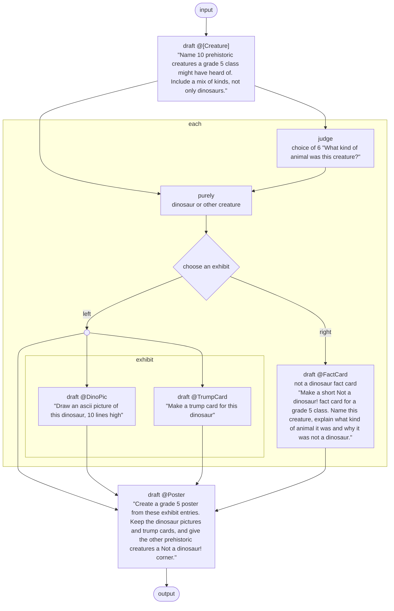
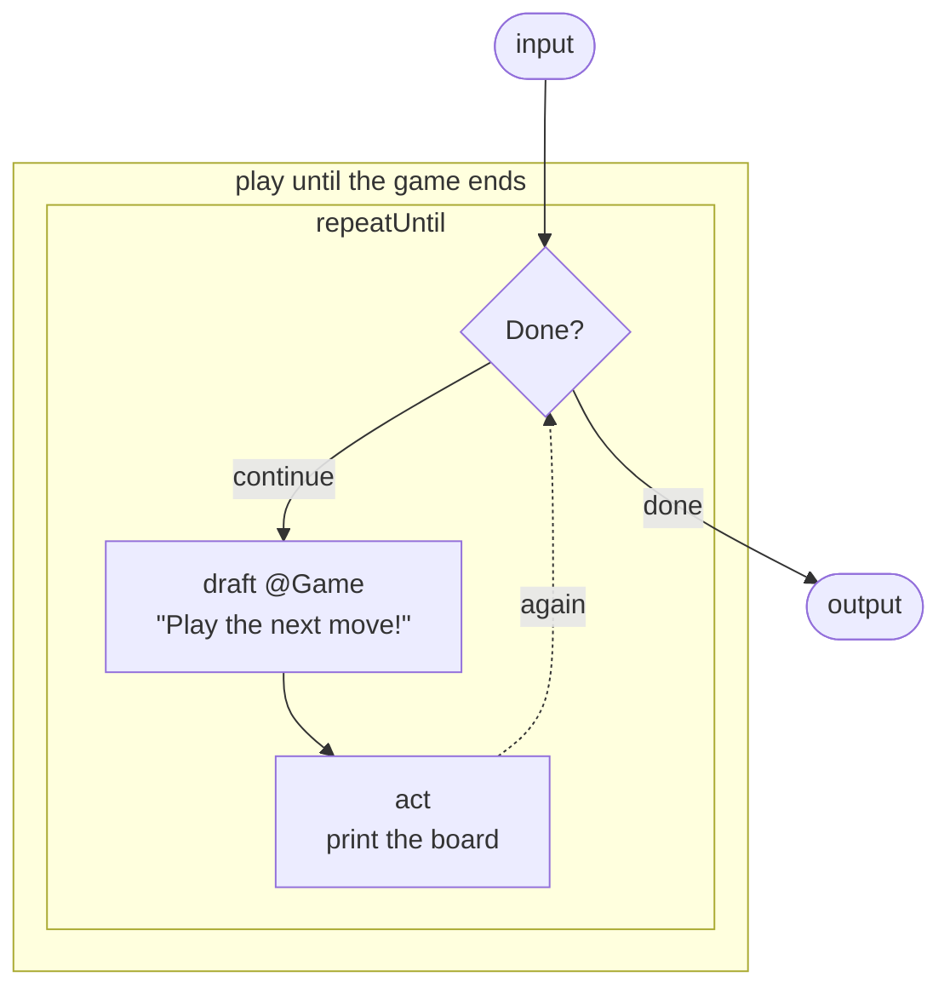
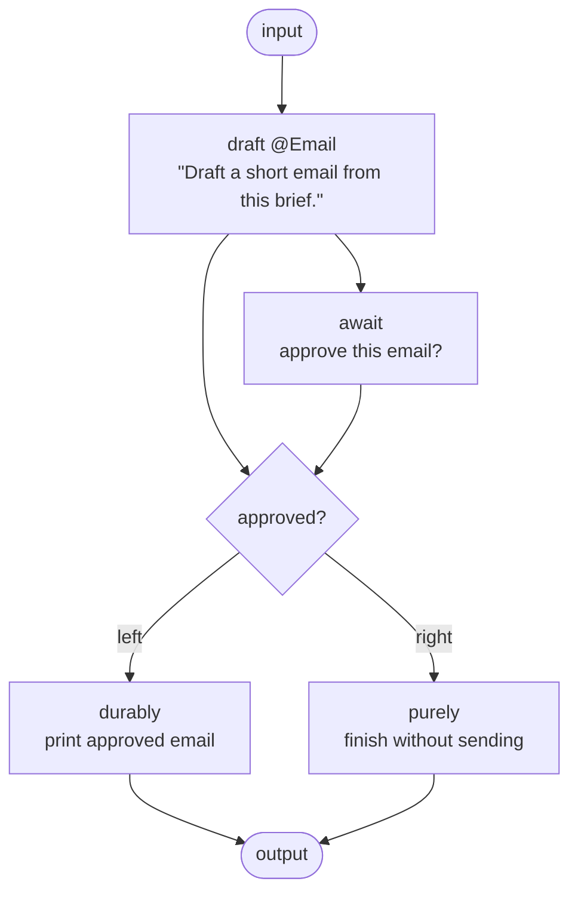

# haskell-agentic

[](https://hackage.haskell.org/package/agentic)
[](https://github.com/drshade/haskell-agentic/actions/workflows/haskell-ci.yml)

I wrote the first version of this a while back, when the best tool we had for
getting structured data out of an LLM was "pls respond in JSON". It worked -
sort of. The model providers have since caught up (strict structured outputs
just work now), so v2 throws away the clever-but-fragile bits and keeps the idea
I still think is right: an agentic workflow should be a typed value you can
compose, look at, and only then run.

So this is a small Haskell library for exactly that. Typed steps, mixing LLMs
(Claude, OpenAI) with [Jev](https://docs.typesafe.ai) for fast, calibrated
judgements - and you can draw the whole flow before you spend a single token.

## Packages

It's split into a handful of packages, so the core stays tiny and you only pull
in the providers you actually use:

| Package             | What it's for                                                                                                              |
|---------------------|----------------------------------------------------------------------------------------------------------------------------|
| `agentic`           | flows, contracts, questions, the runtime and the interpreter (depends only on `base`, `text` and `transformers`; GHC 9.6+) |
| `agentic-jev`       | Jev as System One                                                                                                          |
| `agentic-anthropic` | Claude as System Two (or System One)                                                                                       |
| `agentic-openai`    | OpenAI as System Two (or System One)                                                                                       |
| `agentic-io`        | concurrency, recording and replay, and `.env` loading                                                                      |
| `agentic-aeson`     | shared by the providers: JSON conversions and strict JSON Schema                                                           |
| `examples`          | the examples in this README (not published)                                                                                |

All the examples below live in `examples/` and run against the real models -
`cabal run dino`, `cabal run tictactoe`, `cabal run review`,
`cabal run kitchensink`, `cabal run revision` and `cabal run email-approval`.
Copy `.env.example` to `.env` and fill in your keys first.

## The big idea

A workflow is an `Agentic m i o` - a typed description of how to get from an `i`
to an `o`, running in some effect `m`. I call these flows. You build them out of
steps and click them together with the normal `Arrow` combinators (`>>>`, `&&&`,
`|||`), sort of like lego. Nothing runs until you hand the flow to an
interpreter.

The main steps are:

| Step      | What it does                                                     | Returns                               |
|-----------|------------------------------------------------------------------|---------------------------------------|
| `draft`   | an LLM writes a value, optionally using tools along the way      | any `Contract o`                      |
| `judge`   | Jev answers typed questions about the input                      | answers with calibrated probabilities |
| `act`     | plain code, with any effect `m`                                  | whatever it returns                   |
| `durably` | an effect whose saved result is reused when the run resumes      | any `Persist o`                       |
| `await`   | asks for an external reply, suspending its branch until answered | any `Persist o`                       |
| `purely`     | a pure function - glue between steps                             | whatever it returns                   |

Because a flow is just data, you can `describe` it (print it, or draw it) before
you spend a single token. And because the interpreter is separate, the same flow
runs against real providers, a mock, or a recording. Same code. No changes.

Under the hood there are two types - `Step` for the leaves, which do the actual
work, and `Agentic` for the structure, which wires them together:

```haskell
data Step m i o where
  -- Pass the input through unchanged.
  Pass :: Step m i i

  -- Put the input into the Left or Right alternative of an Either.
  InjectLeft  :: Step m a (Either a b)
  InjectRight :: Step m b (Either a b)

  -- Keep the first or second element of a pair.
  TakeFirst  :: Step m (a, b) a
  TakeSecond :: Step m (a, b) b

  -- Lift a pure function.
  Purely :: (i -> o) -> Step m i o

  -- Lift an effectful function.
  Act :: (i -> m o) -> Step m i o

  -- Lift an effectful function whose result can be journaled and restored.
  Durable :: Codec i -> Codec o
          -> (Maybe DurableKey -> i -> m o) -> Step m i o

  -- Request an external reply; suspend this branch if unanswered.
  Await :: Codec i -> Codec o -> Step m i o

  -- Generate a typed value using System Two, optionally calling tools.
  Draft :: Structure i -> Structure o
        -> Instruction -> [Tool m] -> Step m i o

  -- Answer typed questions about the input using System One.
  Judge :: Structure i -> Questions o -> Step m i o

data Agentic m i o where
  -- Make a one-step flow.
  Step :: Step m i o -> Agentic m i o

  -- Feed the first flow's output into the second.
  Seq :: Agentic m a b -> Agentic m b c -> Agentic m a c

  -- Give both flows the same input and pair their results.
  Fanout :: Agentic m a b -> Agentic m a c -> Agentic m a (b, c)

  -- Run each flow on its half of the input pair and pair their results.
  Split :: Agentic m a b -> Agentic m c d
        -> Agentic m (a, c) (b, d)

  -- Transform one half of a pair; preserve the other.
  First  :: Agentic m a b -> Agentic m (a, c) (b, c)
  Second :: Agentic m a b -> Agentic m (c, a) (c, b)

  -- Run the first flow for Left input, or the second for Right input.
  Choose :: Agentic m a c -> Agentic m b c -> Agentic m (Either a b) c

  -- Apply the flow to every element of a list.
  Each :: Agentic m a b -> Agentic m [a] [b]

  -- Feed each result back into the flow until the predicate holds.
  -- Check before each iteration, so the body may run zero times.
  Repeat :: Agentic m a Bool -> Agentic m a a -> Agentic m a a

  -- Attach a name and optional description to a flow.
  Noted :: Note -> Agentic m i o -> Agentic m i o
```

`Await` marks where a flow can suspend for an external reply. It doesn't do
any waiting itself - it's just data like the rest. In a resumable run, the
interpreter hands the question back if the journal has no answer yet, or carries
on with the answer if it does. Other parallel branches can finish or reach their
own waits before the run returns its questions. `Durable` and `Await` carry codecs
because their values have to survive in that journal. `durably` and `await` pick
them up from `Persist`, and `durablyWith` and `awaitWith` take them by hand.
[Wait for an external reply](#wait-for-an-external-reply) shows how to answer a
question and resume.

The standard Arrow method `arr` is also available; it means the same as
`purely`. The `Arrow` and `ArrowChoice` instances build these constructors directly,
otherwise `describe` would see a tangle of `purely swap` instead of "these run side
by side".

There's deliberately no `ArrowApply` and no `Monad`. I know, I know. But either
one would let a flow pick its next step from a runtime value, and then you
couldn't describe it without running it - which kinda defeats the point.

## Jokes

Let's start with the obvious one:

```haskell
data Joke = Joke { genre :: Text, setup :: Text, punchline :: Text }
  deriving (Generic, Show, Contract)

ghci> run (draft @Joke "a joke please") ()
Joke
  { genre = "Dad joke"
  , setup = "Why did the scarecrow win an award?"
  , punchline = "Because he was outstanding in his field."
  }
```

The step's input becomes the model's context, so you never have to inject it
yourself:

```haskell
data BetterJoke
  = DadJoke    { setup :: Text, punchline :: Text }
  | OneLiner   { line :: Text }
  | KnockKnock { whosThere :: Text, punchline :: Text }
  deriving (Generic, Show, Contract)

ghci> let joke = Joke "knock-knock" "Knock knock. Who's there? Boo." "Don't cry, it's only a joke!"
ghci> run (draft @BetterJoke "convert this joke") joke
KnockKnock {whosThere = "Boo", punchline = "Don't cry, it's only a joke!"}
```

(`run` is shorthand for `interpret` with a runtime built from your environment -
more on that in *Actually running stuff*.)

## Contracts (or: the types are the prompt)

Descriptions make a MASSIVE difference to output quality, so you'll usually
write a contract out rather than derive it:

```haskell
instance Contract Joke where
  contract = record "A joke, split into its parts" $ Joke
    <$> required "genre"     "The style of joke, e.g. pun, dad joke"  (.genre)
    <*> required "setup"     "The setup line"                         (.setup)
    <*> required "punchline" "The line that lands it; no explanation" (.punchline)

instance Contract BetterJoke where
  contract = sumOf "A joke in one of several shapes"
    [ constructor "DadJoke" "A setup and a groan-worthy punchline" isDadJoke $
        DadJoke <$> required "setup" "" (.setup) <*> required "punchline" "" (.punchline)
    , constructor "OneLiner" "A single line" isOneLiner $
        OneLiner <$> required "line" "" (.line)
    , constructor "KnockKnock" "The classic call-and-response" isKnockKnock $
        KnockKnock
          <$> required "whosThere" "" (.whosThere)
          <*> required "punchline" "" (.punchline)
    ]
```

(Or derive it and add descriptions after: `genericContract & field "punchline" "..."`.)

The getters are `(.genre)` and friends because everything here, the library
included, is written with `DuplicateRecordFields`, `NoFieldSelectors` and
`OverloadedRecordDot`.

Contracts compile to the providers' native structured outputs and strict tool
schemas, not to prompt text, so a reply that doesn't match the schema basically
can't happen. This was always the weakest part of v0 - it asked the model nicely
for the right shape and hoped for the best. Checks the schemas can't express,
like `between 1 10`, are checked locally, and a failed one goes back to the
model to try again.

This is the core design assumption: the types ARE the prompt. The input's types
are part of what the model reads, and field names carry meaning. A meeting note
wrapped in a record with `setup` and `punchline` fields looks like a joke before
the model reads a word. So give each step the input it should judge, and no more.

And describe an enumeration once - Claude and Jev both see the same wording (see
`Options` below).

### One contract, several representations

A contract is a typed description of the structure. The model codec is one
interpretation of it; a storage adapter can choose another, with its own
encoding and validation. You still derive `Contract` once.

Normal `draft`, `judge`, and `tool` calls handle compilation for you. When you
want a codec directly:

```haskell
case compileModel (contract @Joke) of
  Left problem -> print problem
  Right codec -> print (codec.encode joke)
```

Custom scalars keep their identity inside records and containers. They can
supply a default model codec, and another library can supply a different
projection without changing their definition. `outline` exposes the
structure even when no model representation is available.

`interpret` checks the whole flow before running effects, including unused
branches and tool results. Unsupported model projections fail there. The core
now requires GHC; MicroHs support has been retired.

## Is it actually funny?

An LLM is great at writing. Jev is great at judging - quickly, and with a
probability you can actually put a threshold on.

```haskell
funny :: Questions YesNo
funny = yesNo "Would a 10-year-old laugh at this joke?"

ghci> run (draft @[Joke] "ten jokes please" >>> keep 0.7 funny) ()
[Joke {...}, Joke {...}, Joke {...}]
```

`keep 0.7` keeps the items Jev says yes to with at least that probability. `gate`
does the same for one value, sending it `Right` if it passes and `Left` if not:

```haskell
kidFriendly :: Agentic m Joke Joke
kidFriendly = gate 0.9 (yesNo "Is this joke suitable for a 10-year-old?")
          >>> (draft "rewrite this joke for a 10-year-old" ||| returnA)
```

Jev also has `choice` and `score`, over an `Options` type:

```haskell
data Groan = Mild | Solid | Unbearable deriving (Generic, Show)

instance Options Groan where
  options = documentedOptions "How much the audience groans"
    [ option Mild       "A polite smile; most people didn't notice"
    , option Solid      "An audible groan from most of the room"
    , option Unbearable "People get up and leave" ]

instance Contract Groan where contract = enumeration

groan :: Questions (Score Groan)
groan = score "How much will the audience groan?"
```

For a `score`, the options are levels, lowest first. And questions about the
same input compose applicatively into ONE request:

```haskell
review :: Agentic m Joke Review
review = judge (Review <$> funny <*> groan)
```

## Give it some tools

Hand a `draft` some tools and it becomes an agent. The model calls them as often
as it likes, and the step finishes when it responds with the output type.

```haskell
research :: Agentic IO Text Dino
research =
  draftWith [fossilSearch, reliable]
    "Research this dinosaur. Cite a source for every claim."

fossilSearch :: Tool IO
fossilSearch = tool "search" "Search the fossil database" (act searchFossils)

reliable :: Tool IO
reliable =
  tool "is_reliable" "Is this source trustworthy?" $
    judge (yesNo "Is this a reliable scientific source?")
```

A tool's body is just another `Agentic` - an effect, a Jev judgement, a pipeline,
or a whole other agent. There's no separate tool system, so anything fancier
(asking a human before a destructive tool, say) you build out of the same pieces:

```haskell
deleteRecord :: Tool IO
deleteRecord =
  tool "delete" "Delete a fossil record"
    (act confirmWithHuman >>> act deleteIfApproved)
```

### Recursive tools

Declare self recursion with `recursiveTool`, or mutual recursion with
`recursiveTools` (up to five tools):

```haskell
researcher :: Tool IO
researcher = recursiveTool $ \self ->
  tool @Text @Text "research" "Research deeper" $
    draftWith [self] "Research this; recurse when useful, then answer."

pingPong :: (Tool IO, Tool IO)
pingPong = recursiveTools $ \(ping, pong) ->
  ( tool @Text @Text "ping" "Ping" (draftWith [pong] "Ask pong or finish.")
  , tool @Text @Text "pong" "Pong" (draftWith [ping] "Ask ping or finish.") )
```

Don't tie the knot yourself: preflight has to walk the flow. Use the members
passed into the builder, and return `tool` definitions. The builder must be
pure; inspect its arguments only with `toolName` and `toolDescription`, and
keep their metadata free of cyclic dependencies. Returning an argument in
place of a definition is an error.

A tool saved by an `act` still belongs to its original group when used in
another flow. The model can recurse past 100 calls, but preflight and describe
reject more than 100 statically nested tool bodies with `ToolNestingLimit 100`.
That catches the old plain knot-tied shape; it also rejects a finite tree 101
tools deep. It isn't cycle detection, and cyclic metadata can still hang.
`capped` limits turns of a draft, not total recursion depth.

### How the loop works

The core runs the loop and a provider only ever takes one turn, so it behaves
the same against a real provider, a mock or a replay. A few things worth
knowing:

- There's no turn limit - the model decides when it's done. Want a cap? Wrap the
  runtime (`capped 20`).
- A bad tool call (unknown name, input that doesn't decode) goes back to the
  model. But a failure *inside* a tool's body escapes the step, like any other
  error in `m` - if you want the model to see it, put it in the tool's output
  type (`Either NotFound Fossil`).
- A `draftWith` inside a tool is a sub-agent with its own conversation.
- The conversation stays inside the step. Only the typed result moves on.

## Example: The dino project

A grade 5 project - and a flow that mixes both kinds of model. Claude suggests
ten prehistoric creatures. Jev classifies each one, then the flow chooses its
exhibit. A dinosaur gets an ASCII picture and a trump card, made side by side.
Pterosaurs and plesiosaurs are the classic "not actually dinosaurs" - sorry
kids. They and the other creatures get a short "Not a dinosaur!" fact card.
Claude combines all the entries into one poster.

```haskell
dinoProject :: Agentic IO () Poster
dinoProject =
  draft @[Creature] "Name 10 prehistoric creatures a grade 5 class might have heard of. \
    \Include a mix of kinds, not only dinosaurs."
    >>> each creatureExhibit
    >>> purely Exhibit
    >>> draft @Poster "Create a grade 5 poster from these exhibit entries. Keep the dinosaur \
      \pictures and trump cards, and give the other prehistoric creatures a \
      \Not a dinosaur! corner."

-- | Classify once, then run only the chosen kind of exhibit.
creatureExhibit :: Agentic IO Creature ExhibitEntry
creatureExhibit =
  classify
    >>> purely route `named` "dinosaur or other creature"
    >>> ((exhibit >>> purely DinosaurExhibit) ||| (factCard >>> purely OtherExhibit))
          `named` "choose an exhibit"

-- | Jev decides what kind of animal each creature was, keeping the creature.
classify :: Agentic IO Creature (Creature, Choice Kind)
classify = returnA &&& judge (choice "What kind of animal was this creature?")

-- | Follow the chosen kind. Low confidence is not evidence of a different kind.
route :: (Creature, Choice Kind) -> Either Creature NotADinosaur
route (c, k)
  | k.chosen == Dinosaur = Left c
  | otherwise = Right (NotADinosaur c k.chosen)

factCard :: Agentic IO NotADinosaur FactCard
factCard = draft @FactCard "Make a short Not a dinosaur! fact card for a grade 5 class. Name this \
  \creature, explain what kind of animal it was and why it was not a \
  \dinosaur."
  `named` "not a dinosaur fact card"

exhibit :: Agentic IO Creature Entry
exhibit =
  (returnA &&& draft @DinoPic "Draw an ascii picture of this dinosaur, 10 lines high"
           &&& draft @TrumpCard "Make a trump card for this dinosaur")
    `named` "exhibit"
    >>> purely (\(dinosaur :/\ picture :/\ card) -> Entry dinosaur picture card)
```

`route` makes the choice explicit: `Left` is a dinosaur, `Right` is another
kind of creature. `|||` runs only that side. Both sides produce an
`ExhibitEntry`, tagged as `DinosaurExhibit` or `OtherExhibit`, so the poster
receives one ordered list in `Exhibit.entries`. Birds count as dinosaurs here.

`a &&& b &&& c` builds the nested pair `(a, (b, c))`, and `:/\` matches it
without the brackets: `dinosaur :/\ picture :/\ card`. It works as a type too.
The trump card's `Stat` contract checks 1 to 10, so every card uses the same
scale. The whole example, including its types, is in `examples/Dino.hs`.

You could also write `exhibit` with `proc` notation, since `Agentic` is an
`Arrow`:

```haskell
exhibit :: Agentic IO Creature Entry
exhibit = proc creature -> do
  pic   <- draft @DinoPic "Draw an ascii picture of this dinosaur, 10 lines high" -< creature
  stats <- draft @TrumpCard "Make a trump card for this dinosaur" -< creature
  returnA -< Entry creature pic stats
```

It reads nicely, but GHC turns `proc` into a chain of `first`s, never `&&&`. So
the picture and the trump card run one after the other instead of side by side,
and `describe` shows GHC's plumbing rather than the shape of the flow:

```
both halves
├─ first → draft @DinoPic  "Draw an ascii picture of this dinosaur, 10 lines high"
└─ second → pass
both halves
├─ first → draft @TrumpCard  "Make a trump card for this dinosaur"
└─ second → pass
```

So for steps that don't depend on each other, stick with `&&&`.

### Describe it before you run it

```
ghci> import Control.Exception (throwIO)
ghci> d <- either throwIO pure (describe dinoProject)
ghci> print d
draft @[Creature]  "Name 10 prehistoric creatures a grade 5 class might have heard of. Include a mix of kinds, not only dinosaurs."
each
├─ judge  choice of 6 "What kind of animal was this creature?"  (keeping its input)
├─ purely  dinosaur or other creature
└─ choose an exhibit  branch
   ├─ left → exhibit  together  (keeping its input)
   │  ├─ draft @DinoPic  "Draw an ascii picture of this dinosaur, 10 lines high"
   │  └─ draft @TrumpCard  "Make a trump card for this dinosaur"
   └─ right → draft @FactCard  not a dinosaur fact card  "Make a short Not a dinosaur! fact card for a grade 5 class. Name this creature, explain what kind of animal it was and why it was not a dinosaur."
draft @Poster  "Create a grade 5 poster from these exhibit entries. Keep the dinosaur pictures and trump cards, and give the other prehistoric creatures a Not a dinosaur! corner."
```

`mermaid` and `dot` draw the same flow as a diagram of how the data moves
(GitHub draws Mermaid inline, and Graphviz renders `dot` offline). Here's the
dino project. The diamond chooses an exhibit; its left edge leads to the
parallel dinosaur drafts, and its right edge leads to the fact card:



`describe` returns `Either FlowError Description`. Invalid recursion and excessive
tool nesting are errors, rather than an excuse to draw a truncated picture. It
doesn't run effects or compile model codecs, so you can still inspect a flow
whose contracts a model provider can't handle.

The `Description` can be rendered as a tree or diagram, or turned into JSON with
`descriptionValue`. Recursive definitions and references are finite; their
addresses belong to this captured flow only. Diagrams show the tools and their
bodies, with references for recursion. A choice is a diamond with a left and a
right edge. A dot is just a fork in the picture, not another step to run.

The diagram follows each half of a pair from `&&&` or `***` to wherever it
goes next, but it can't see inside a `purely`, so `purely fst` loses track of which
step the half came from. `takeFirst` and `takeSecond` do the same job and keep
it.

### Naming things

A `purely` or an `act` is opaque to `describe`, so you name it. `named` binds as
tightly as function application, so it names exactly the expression before it:

```haskell
    >>> purely route `named` "dinosaur or other creature"
```

Without it, the code that routes creatures to their exhibits would be invisible.
Bracket a bigger sub-flow to name all of it, and use `note` to add a description
too. Names also tag every trace event, so they stay useful well
after the flow is written. My rule of thumb: an instruction is written for the
model, and a name is written for whoever's watching.

## Example: Tic-tac-toe

The model plays both sides. Given the game so far it plays the next move, and
`repeatUntil` goes round again until the model says the game is over.

```haskell
data Square = Blank | X | O
data Row = Row {left :: Square, centre :: Square, right :: Square}
data Board = Board {top :: Row, middle :: Row, bottom :: Row}
data State = Playing | Ended
data Game = Game {board :: Board, state :: State}
-- all deriving (Generic, Show, Contract)

nextMove :: Agentic IO Game Game
nextMove = draft @Game "Play the next move!"

game :: Agentic IO Game Game
game =
  repeatUntil (purely ((== Ended) . (.state)))
    (nextMove >>> act printBoard `named` "print the board")
    `named` "play until the game ends"
```

Notice the instruction doesn't explain the rules. It doesn't need to! The types
say there's a 3×3 board of `Blank`, `X` and `O`, and a game that's either
`Playing` or `Ended` - the model knows the rest. `describe` shows the loop:

```
play until the game ends  repeatUntil
├─ test → purely
└─ body
   ├─ draft @Game  "Play the next move!"
   └─ act  print the board
```

The loop is small enough to see at a glance. The `again` edge returns to the
test; the `done` edge lets an already-ended game leave without playing:



`repeatUntil` is the only loop in the language, and it checks its condition
before each round. In the diagram that check is the `Done?` diamond, so a game
that's already over goes straight past the body.

`cabal run tictactoe` plays a game on OpenAI, where the dino
project runs on Claude - same flow code either way.

The [other example diagrams](https://github.com/drshade/haskell-agentic/blob/main/examples/diagrams/README.md)
include the small Jev review and the much larger KitchenSink flow. KitchenSink
has its own page so the full combination of tools, loops and choices doesn't
swamp this walkthrough.

## Example: Review and revise

A loop's test is a flow too. It can call a model, perform an effect, or ask
someone a question with `await`. Here Jev judges the current joke before
Claude revises it:

```haskell
revise :: Agentic IO Joke Joke
revise =
  repeatUntil
    ((judge (yesNo "Would a 10-year-old laugh at this joke?")
      >>> purely ((>= 0.8) . (.yes))) `named` "Funny enough?")
    (draft @Joke "Improve this joke for a 10-year-old." `named` "Revise joke")
```

The test returns a Bool; the body receives the current joke. If the first
review passes, the joke is returned unchanged. Otherwise the revised joke
goes through the test again. `cabal run revision` runs the
[complete example](https://github.com/drshade/haskell-agentic/blob/main/examples/Revision.hs).

## Example: The kitchen sink

Want to see everything at once? `examples/KitchenSink.hs` is a day of support
email at an online bookshop. Claude writes the day's inbox. Jev drops the spam
(`keep`) and triages each email with three questions in one request - a `choice`
of topic, a `score` of urgency, and a `yesNo` "is the customer angry?" - and a
named policy (`note`, `purely`) turns that into a ticket. Urgent and routine tickets
are handled side by side (`***`). Refunds go to an agent with two tools, an
order lookup (`act`) and a refund-policy check (`judge`), and everything else
gets a plain reply (`|||`). Each reply is polished until Jev rates it polite
(`repeatUntil`) while a log line is written alongside it (`&&&`), then sent
(`act`), and urgent tickets also page the on-call team. Claude ends the day with
a report.

The runtime runs independent work at the same time (`concurrently`) and records
every model call (`withStore`), so a second run replays the first. (Claude's
first drafts are usually polite enough already, so the polish loop tends to
hand them straight back.)

## Actually running stuff

A runtime has two roles to fill. System One answers `judge` steps - fast, typed
judgements with probabilities. System Two answers `draft` steps - an LLM taking
turns. You pick one provider for each:

```haskell
main :: IO ()
main = do
  rt <- pure runtime
    >>= withSystemOne jev
    >>= withSystemTwo (anthropic & model "claude-opus-5-5")
    <&> concurrently . observing logEvent
  poster <- interpret rt dinoProject ()
  print poster
```

Each provider has a default config you tweak with setters, like
`anthropic & model "claude-sonnet-5-5" & effort Low`. Keys come from the
environment (`JEV_TOKEN`, `ANTHROPIC_API_KEY`, `OPENAI_API_KEY`), or from a
`.env` file via `loadDotEnv`.

Jev only does System One, so `withSystemTwo jev` is a type error (nice!). The LLM
providers can fill both roles - this runs everything on OpenAI, no Jev token
needed:

```haskell
rt <- pure runtime
  >>= withSystemOne (openai & model "gpt-6-astra")
  >>= withSystemTwo (openai & model "gpt-6-astra")
```

Fair warning though: an LLM answering as System One gives you probabilities, but
they aren't calibrated the way Jev's are, so a `gate 0.9` means a lot less.

### What about prompts? And sessions?

A system prompt for every `draft` is a setting
(`anthropic & system "You write for primary school children."`).

The library never tells the model how to format its reply - the providers'
strict structured outputs take care of that. What the model gets is meaning: the
instruction, the input, and your contracts' descriptions.

And there are no sessions to manage. Anything a later step needs goes through
the types. Memory across runs is yours to own - put it in the flow's types, or
behind tools that read and write a store.

### Record once, replay for free

`withStore` records every model call to a file and replays it later:

```haskell
rt <- pure runtime
  >>= withSystemOne jev
  >>= withSystemTwo anthropic
  >>= withStore ReplayOrRecord "dino.jsonl"
```

Each answer is keyed by its whole request, so it's replayed only when the model
would be asked exactly the same thing. Three modes:

- `Record` calls the models and writes a fresh file.
- `Replay` answers only from the file (great for tests that are real but free).
- `ReplayOrRecord` replays what it has and records the rest - perfect while
  you're working on the end of a long flow.

Only model calls are stored though - `act` steps and tool bodies run for real.

For tests, swap in scripted providers from `Agentic.Scripted` - same flow, no
network:

```haskell
testRuntime :: IO (Runtime IO)
testRuntime = do
  two <- scripted [respond joke]
  pure runtime { systemOne = fixedAnswers 0.95, systemTwo = two }
```

### Follow a run on its graph

`observing` gets an `Event` for every node a run enters - not just the model
calls, the plumbing too. Each event says which occurrence it belongs to and who
its parent is, so you can light up the graph from `describe` as the run goes:

```haskell
d <- either throwIO pure (describe flow)
let graph = flowGraph d
    rt = observing (save . summaryValue . summarise) runtime
save (flowGraphValue graph)
interpret rt flow input
```

`save :: Value -> IO ()` is yours - the library has no recorder, clock or
transport. `summarise` drops optional provider values and diagnostics without retaining
the discarded payloads.

An occurrence is an address in the flow plus where it sits in its loops and tool
calls (which element, which pass, which call). That is what makes recursion
work: a tool that calls itself is one node in the graph and a new occurrence
every time. `graph.addressItems` maps each address to the item that shows it,
and `graph.bodies` identifies loop tests, loop bodies and possible tool-call targets.
`flowGraphValue` encodes the complete graph, including those relationships,
selection IDs and reference edges. Save it next to the summaries
from the same flow - `descriptionValue` is for reading, this is for replaying.

`Entered` and `Drafting` tell you where the interpreter is, not whether it's
doing new work. For that there are two events. `Restored` means the result
came out of the journal. `Executing` means the step was picked to run for
real - and picked is all it means, because the observer can still fail or be
cancelled before the action or the model is called. If you've seen neither
yet, you don't know yet.

It's per step, and per turn inside a draft. A resumed run can restore one turn
and run the next one live, so there's no point where the whole run flips from
replay to live.

A few things that will bite you:

- An occurrence is `Entered`, then `Returned`, `Failed` or `Cancelled`. A
  timeout or a cancelled sibling is `Cancelled`, not `Failed`.
- `Returned` doesn't force the result. A lazy value can still blow up later, in
  whichever step demands it.
- `each` reports its total on entry, so it walks the whole list first. No
  infinite lists.
- Once a recording ends, no terminal means an unknown outcome. A process can
  die, or an observer can throw, leaving an occurrence open.
- Under `concurrently` several branches can call your observer at once.
  Serialise it yourself.
- The supplied IO runtime observes failures. With `runtimeWith` you get
  `Entered` and `Returned`, unless you supply a `Scope` that sees other exits.
- Addresses belong to the graph they came from. Store them together, and don't
  match them across versions of a flow.
- A provider's call ids can repeat, so never key on them alone.

For a flow in `ExceptT`, lift the hook so a `Left` shows up as `Failed` on
every scope it passes through:

```haskell
import Control.Monad.Trans.Except (ExceptT, runExceptT, throwE)

rt :: Runtime (ExceptT FlowError IO)
rt = (runtimeWith throwE) { scope = exceptTScope ioScope }
-- runExceptT (interpret rt flow input)
```

One `exceptTScope` per `ExceptT` layer. And one oddity - if a timeout lands
while a failure is being reported, you can get the original `Left` back
(`Just (Left e)`), rather than a timeout.

It isn't free either - every node pays a little even with no observer, and a
plumbing-heavy `each` emits a lot of events.
`cabal bench agentic:observation-overhead` shows you what it costs.

None of this touches `withStore` - recorded answers stay valid.

### Save a run and continue it later

`withStore` caches model answers while you edit a prompt. Resuming one
particular run is a different job, and that's `withJournal`. It saves every
model turn, judgement and completed tool call by where it sits in the run, so
the next attempt picks up where the last one stopped.

An `act` has no way to save its result, so there's `durably` - an `act` whose
input and result are saved:

```haskell
import Agentic
import Agentic.IO (withJournal)
import Data.Text (Text)

sendStep :: Agentic IO Text Text
sendStep = durably $ \stableKey message ->
  sendMessage (durableKeyText <$> stableKey) message

resume :: IO Text
resume = do
  rt <- withJournal "run-42.jsonl"
    (JournalIdentity "run-42" "workflow-v1") runtime
  interpret rt sendStep "Hello"
```

`sendMessage` is yours. Run `resume` twice and the message goes out once - the
second time the saved result comes back through the codec, and anything past
the saved part runs live.

A saved result is found by its position: which step, which element of an
`each`, which pass of a `repeatUntil`, which tool call. Not by what was asked.
So the same request in two places is two entries.

A tool call that finished is restored whole, and its body doesn't run. One that
stopped part way runs its body again, restoring the `durably` steps and inner
tool calls that did finish.

Saving goes through `Persist`. Text, integers, booleans, lists, tuples, `Maybe`
and `Either` already have it. For your own types, derive it next to `Generic`:

```haskell
data Approval = Approve | Reject
  deriving (Generic, Persist)
```

This isn't the `Contract`. A contract is what the model sees, and it can leave
fields out. `Persist` saves every field.

What to know about it:

- There's no `Double` or `Float`, and no `Char` or `String`. JSON can't hold
  every one of them, so use `Text`, or bring your own codec.
- A type that contains itself isn't supported. A derived one gets you
  `RecursivePersistence` as soon as the flow is built - it doesn't hang. One
  hidden behind a hand-written codec, or one whose type grows at every level,
  isn't caught and can still hang.
- Names are stored as you wrote them. Rename a field or a constructor, or add
  a field, and old journals stop decoding. Nothing is defaulted. Change the
  revision when you change a type.
- An enum with no fields is stored as a string. Give one of its constructors a
  field and the stored form of all of them changes.
- For a type that needs its own codec, write `persist = persistWith myCodec`.
  Or use `durablyWith` and `awaitWith`, which take the codecs for that one
  step.

A few things that will bite you:

- A `durably` step can run more than once. If it ran but its result wasn't
  saved (the process died, it threw), it runs again next time. Make it safe to
  repeat. The key is the same on every attempt, so pass it on if the other
  side can dedupe. It can get long - hash it if the service caps the length.
  It's `Nothing` when the runtime has no journal.
- A plain `act` runs every time, resume or not. If its result matters after a
  restart, make it `durably`.
- Nothing checks that a resumed run takes the same path. If an `act` returns
  something different and that changes a branch or a loop, the run just goes
  the new way. If it changes the input of a step that was saved, the resume
  fails there - it won't hand you a stale result.
- Resume with the same input you started with. Nothing can check that either.
  `runIn` (further down) saves the input and hands it back for you.
- The second name in `JournalIdentity` is your revision. Change it when the
  code, the codecs or the provider config change, and old journals are refused.
  They don't migrate.
- Only returned values come back. Whatever a skipped step did to an `IORef` is
  gone.
- A nested `interpret` (from inside an `act`) needs a journal of its own.
- A journal error is never a reason to run the step again. A different run or
  revision, a changed request, a result that no longer decodes - all of them
  fail the run.

The file is one JSON object per line and nothing clever. Use it from one
process at a time (nothing stops you doing otherwise). A line it can't read
fails the load, and that includes a half-written last line, so a crash in the
middle of a write can leave a file that won't open. There's no repair, no
locking and no promise about power loss. If you need more than that, write
your own - `Runtime.journal` takes a `Journal` with three hooks (`initialise`,
`lookupRecord`, `saveRecord`) and they work in any monad.

Every entry keeps the whole request next to its result, to check against on
the way back. A draft's request includes its history, so a long conversation
makes for a big journal. Your own store is free to compress that.

When you're observing, a restored step emits `Restored` between `Entered` and
`Returned`. A draft marks each restored turn separately, and nothing is emitted
for the inside of a tool body that was skipped. Keep each attempt's events in
their own recording.

### Wait for an external reply

Sometimes a flow has to ask a person something, and the answer might take two
days. You don't want a process sat there for two days. `await` asks, and if
the reply isn't in the journal yet the run stops and tells you what it's
waiting for.

The easy way is to let `Agentic.IO` look after the files:

```haskell
askStep :: Agentic IO Text Bool
askStep = await @Bool

leave :: Run Text Bool
leave = runIn "leave-request"
  (JournalIdentity "request-42" "leave-v1") runtime askStep

ask :: IO ()
ask = startRun leave "Can Sam take Friday off?" >>= report

answer :: Int -> Bool -> IO ()
answer ticket yes = answerRun leave ticket yes >>= \case
  Right progress -> report progress
  Left refused -> T.putStrLn (answerRefusalText refused)

report :: Progress Bool -> IO ()
report = \case
  RunFinished yes -> print yes
  RunWaiting _ -> questions leave >>= mapM_ sendQuestion
```

`sendQuestion` is yours. `ask` comes back `RunWaiting` and the process can
exit. Every question has a ticket - a small number that stays the same across
restarts and is never used twice - and that's what you hand to whoever is
answering. `answer` checks the reply, saves it and carries on with the run.

`runIn` keeps everything in that directory: the input you started with, the
journal and the questions that are open. So `resumeRun leave` needs nothing
from you, and `questions leave` reads the open questions without running
anything. `asked @Text question` gives you the request back as your own type.

- `startRun` wants a directory that doesn't exist yet, or an empty one. For a
  run that's already there, use `resumeRun`.
- One command at a time per directory.
- The open questions only change when an attempt comes back `RunFinished` or
  `RunWaiting`. One that fails leaves them as they were.
- A ticket that's closed comes back as `QuestionClosed`.
- A reply of the wrong type comes back as `AnswerRejected` and nothing is
  saved. That's checked when you answer - the compiler can't see it.
- If the reply arrives as JSON, `answerRunValue` takes a `Value`.
- Give `runIn` a runtime without a journal. It adds its own.
- Trouble with the files is an exception, not a refusal.

If you'd rather own the storage - a database, a queue, whatever you have - the
pieces underneath are there. This is the same `askStep`:

```haskell
attempt :: IO ()
attempt = do
  rt <- withJournal "run-42.jsonl"
    (JournalIdentity "run-42" "workflow-v1") runtime
  resumable rt askStep "Can Sam take Friday off?" >>= \case
    RunFinished reply -> print reply
    RunWaiting waits -> mapM_ sendWait waits

answerWait :: PendingWait -> Value -> IO ()
answerWait wait reply = do
  rt <- withJournal "run-42.jsonl"
    (JournalIdentity "run-42" "workflow-v1") runtime
  fulfil rt askStep wait reply >>= \case
    Right () -> attempt
    Left refused -> askAgain wait refused
```

`sendWait` and `askAgain` are yours. The first `attempt` comes back
`RunWaiting` and the process can exit. When the reply turns up, `answerWait`
checks it and saves it, and the next `attempt` picks up from the journal and
carries on past the `await`. There's no separate resume - it's the same replay
as before, with one more entry to restore.

The library never sends anything. It hands you the request and you get it to
whoever needs to see it, however you like.

A `PendingWait` is plain data: the run, the key, the request and the schemas
of the request and the reply. `pendingWaitValue` and `pendingWaitFromValue`
turn it into a JSON value and back, so you can store it and answer from a
different process. Who to ask and by when go in your own request type.

`fulfil` checks the reply with the real codec from the flow, not with the
schema, and it does that before anything is saved. A reply that doesn't decode
comes back as `ReplyInvalid` and you can ask again. It finds the `await` by
walking the flow - no action runs and no model is called.

Waits in parallel are reported together. Ask three people under `each` and the
first attempt gives you three waits; answer any one and run again, and you get
the two that are left. Put the steps in sequence and they come one at a time,
because the second isn't reached until the first is answered. So you choose by
how you write the flow.

A wait in one branch doesn't stop the others. They carry on until they finish
or reach a wait of their own, and the `durably` steps they completed are saved.

A few things that will bite you:

- You only hear about the waits the run reached. A branch that never returns
  means you never get an answer at all.
- A wait that hasn't been answered is reported again on the next attempt. Keep
  track by its key so nobody is asked twice.
- There's no cancel. If nobody answers, make that a value in your reply type
  and supply it - then the flow decides what happens next.
- If a wait from last time isn't in this attempt's list, the run no longer
  wants it. That only holds when the attempt came back `RunFinished` or
  `RunWaiting`. One that failed tells you nothing, so keep what you had. And
  only compare attempts of the same run, one after another - never two at the
  same time.
- A reply to a wait that was dropped is still saved if you supply it. Whether
  to take late replies is up to you.
- The same reply twice is fine. A different one comes back as
  `ReplyAlreadyAnswered`. Answer one wait at a time (two at the same moment can
  race).
- `fulfil` proves the reply fits the reply type. It doesn't prove the wait is
  still wanted, or who answered.
- Plain `interpret` on a flow that waits fails with `AwaitNeedsResume`. Use
  `resumable`.
- An `await` needs a journal. Without one there is nowhere for a reply to come
  back to.
- A nested `interpret` that waits fails the run around it. Use `resumable` in
  there and deal with the outcome yourself.
- Inside a tool it works the same way. The tool didn't finish, so it's entered
  again next time, and a plain `act` before the `await` runs again.

None of this needs `IO`. It works in any monad a flow already runs in.

When you're observing, a step that is waiting ends with `Suspended`, and so
does every scope that stopped because of it. It isn't `Failed`. Once the reply
is in, the step emits `Restored` like any other saved step.

### Example: email approval

Claude drafts an email and you get to read it before it goes out. The flow
asks, the process exits, and you approve or reject it whenever you get round
to it. This is the whole flow, from `examples/EmailApproval.hs`:

```haskell
data Email = Email {subject :: Text, body :: Text}
  deriving (Eq, Show, Generic, Contract, Persist)

data Decision = Approve | Reject deriving (Eq, Show, Generic, Persist)

emailApproval :: (Email -> IO ()) -> Agentic IO Text ()
emailApproval send =
  draft @Email "Draft a short email from this brief."
    >>> (returnA &&& await @Decision `named` "approve this email?")
    >>> purely (\(mail,approved) -> if approved == Approve then Left mail else Right ())
    >>> ((durably (\_ mail -> send mail) `named` "print approved email")
      ||| purely id `named` "finish without sending") `named` "approved?"
```

And the diagram it generates. The draft goes two ways - to you, and to the
choice at the end:



Start a run, and give it a directory that doesn't exist yet:

```sh
cabal run email-approval -- email-run start "Tell Sam the café opens on Friday."
```

It prints the draft and `Approve or reject question 0.` and exits. `resume`
shows you the same draft again, and Claude isn't called a second time:

```sh
cabal run email-approval -- email-run resume
```

Then answer it:

```sh
cabal run email-approval -- email-run approve 0
```

That prints `FAKE SEND (no email delivered)` and the email, then `Finished.`
With `reject 0` you just get `Finished.` Run `resume` after that and nothing is
sent again, and a second answer to question 0 is refused.

Nothing is really sent - the sender is a print. Each run lives in its own
directory, so pick another name to start another one.

## History

v0 - the Kleisli-arrow prototype that used Dhall as its output format (bless
it) - is tagged `v0-prototype`.

Anything I've missed, or something you'd build differently? Issues and PRs very
welcome!
