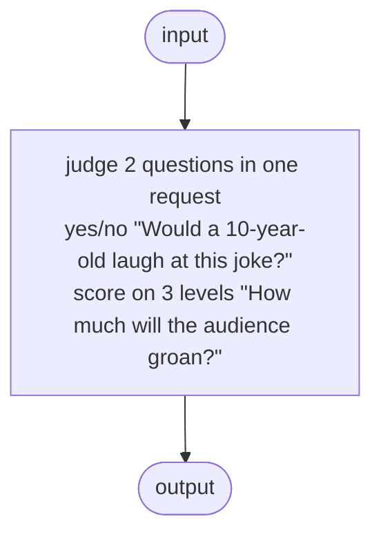

# Example diagrams

These diagrams come from the runnable examples, without invoking providers.
The main README embeds [Dino](../../README.md#example-the-dino-project) and
[Tic-tac-toe](../../README.md#example-tic-tac-toe).

## Review

One Jev call answers two questions about the same joke.



## KitchenSink

This is the full composition example: choices, parallel work, loops and tool
bodies in one flow. It is intentionally larger than the README walkthroughs.

```mermaid
flowchart TD
  input(["input"])
  n_flow_seq_0_0["draft @[Email]<br/>#quot;Write 8 emails to the support address of an online bookshop, as they might arrive in a day. Include one spam email, one refund request and one angry customer.#quot;"]
  n_flow_seq_1_seq_0_fan_0_note_0["arr<br/>count the emails"]
  subgraph n_flow_seq_1_seq_0_fan_1_0["keep 0.5"]
    subgraph n_flow_seq_1_seq_0_fan_1_note_seq_0_0["each"]
      n_flow_seq_1_seq_0_fan_1_note_seq_0_each_fan_1_0["judge<br/>yes/no #quot;Is this a genuine email from a customer, not spam?#quot;"]
    end
  end
  subgraph n_flow_seq_1_seq_1_seq_0_split_1_seq_0_0["each"]
    n_flow_seq_1_seq_1_seq_0_split_1_seq_0_each_seq_0_fan_1_0["judge 3 questions in one request<br/>choice of 5 #quot;What is this email about?#quot;<br/>score on 3 levels #quot;How urgent is this email?#quot;<br/>yes/no #quot;Is the customer angry?#quot;"]
    n_flow_seq_1_seq_1_seq_0_split_1_seq_0_each_seq_1_note_0["arr<br/>triage policy<br/>Urgent if Jev scores it above Soon, or the customer is angry"]
  end
  n_flow_seq_1_seq_1_seq_0_split_1_seq_1_seq_0_note_0["arr<br/>split off the urgent tickets"]
  subgraph n_flow_seq_1_seq_1_seq_0_split_1_seq_1_seq_1_split_0_0["each"]
    n_flow_seq_1_seq_1_seq_0_split_1_seq_1_seq_1_split_0_each_seq_0_seq_0_fan_0_seq_0_seq_0_note_0["arr<br/>refunds to the refund agent"]
    n_flow_seq_1_seq_1_seq_0_split_1_seq_1_seq_1_split_0_each_seq_0_seq_0_fan_0_seq_0_seq_1_0{" "}
    entry_flow_seq_1_seq_1_seq_0_split_1_seq_1_seq_1_split_0_each_seq_0_seq_0_fan_0_seq_0_seq_1_select_0((" "))
    entry_flow_seq_1_seq_1_seq_0_split_1_seq_1_seq_1_split_0_each_seq_0_seq_0_fan_0_seq_0_seq_1_select_1((" "))
    n_flow_seq_1_seq_1_seq_0_split_1_seq_1_seq_1_split_0_each_seq_0_seq_0_fan_0_seq_0_seq_1_choose_0_fan_1_0["draft @Reply<br/>#quot;This customer wants a refund. Look up their order, check the request against the refund policy, and write a reply that tells them the outcome.#quot;"]
    tool_n_flow_seq_1_seq_1_seq_0_split_1_seq_1_seq_1_split_0_each_seq_0_seq_0_fan_0_seq_0_seq_1_choose_0_fan_1_tool_0_0[/"tool lookup_order"/]
    n_flow_seq_1_seq_1_seq_0_split_1_seq_1_seq_1_split_0_each_seq_0_seq_0_fan_0_seq_0_seq_1_choose_0_fan_1_tool_0_0["act"]
    return_n_flow_seq_1_seq_1_seq_0_split_1_seq_1_seq_1_split_0_each_seq_0_seq_0_fan_0_seq_0_seq_1_choose_0_fan_1_tool_0_0(["return"])
    tool_n_flow_seq_1_seq_1_seq_0_split_1_seq_1_seq_1_split_0_each_seq_0_seq_0_fan_0_seq_0_seq_1_choose_0_fan_1_tool_1_0[/"tool refund_eligible"/]
    n_flow_seq_1_seq_1_seq_0_split_1_seq_1_seq_1_split_0_each_seq_0_seq_0_fan_0_seq_0_seq_1_choose_0_fan_1_tool_1_0["judge<br/>yes/no #quot;Our policy: refunds within 30 days of purchase, for damaged books or books that weren't what was ordered. Does this request fit the policy?#quot;"]
    return_n_flow_seq_1_seq_1_seq_0_split_1_seq_1_seq_1_split_0_each_seq_0_seq_0_fan_0_seq_0_seq_1_choose_0_fan_1_tool_1_0(["return"])
    n_flow_seq_1_seq_1_seq_0_split_1_seq_1_seq_1_split_0_each_seq_0_seq_0_fan_0_seq_0_seq_1_choose_1_fan_1_0["draft @Reply<br/>#quot;Write a helpful reply to this customer's email.#quot;"]
    subgraph n_flow_seq_1_seq_1_seq_0_split_1_seq_1_seq_1_split_0_each_seq_0_seq_0_fan_0_seq_1_0["polish<br/>Revise until Jev rates the reply polite (≥ 0.9)"]
      n_flow_seq_1_seq_1_seq_0_split_1_seq_1_seq_1_split_0_each_seq_0_seq_0_fan_0_seq_1_note_seq_0_fan_1_seq_1_seq_1_0["judge<br/>yes/no #quot;Is this reply polite and warm?#quot;"]
      subgraph n_flow_seq_1_seq_1_seq_0_split_1_seq_1_seq_1_split_0_each_seq_0_seq_0_fan_0_seq_1_note_seq_1_seq_0_0["repeatUntil"]
        n_flow_seq_1_seq_1_seq_0_split_1_seq_1_seq_1_split_0_each_seq_0_seq_0_fan_0_seq_1_note_seq_1_seq_0_repeat_seq_1_seq_0_split_1_0["draft @Reply<br/>#quot;Make this reply warmer and more polite, keeping what it says.#quot;"]
        n_flow_seq_1_seq_1_seq_0_split_1_seq_1_seq_1_split_0_each_seq_0_seq_0_fan_0_seq_1_note_seq_1_seq_0_repeat_seq_1_seq_1_fan_1_seq_1_seq_1_0["judge<br/>yes/no #quot;Is this reply polite and warm?#quot;"]
      end
    end
    n_flow_seq_1_seq_1_seq_0_split_1_seq_1_seq_1_split_0_each_seq_0_seq_0_fan_1_0["draft @Text<br/>#quot;Write a one-line log entry for this support ticket.#quot;"]
    n_flow_seq_1_seq_1_seq_0_split_1_seq_1_seq_1_split_0_each_seq_0_seq_1_seq_1_note_0["act<br/>send the reply"]
    n_flow_seq_1_seq_1_seq_0_split_1_seq_1_seq_1_split_0_each_seq_1_note_0["act<br/>page the on-call team"]
  end
  subgraph n_flow_seq_1_seq_1_seq_0_split_1_seq_1_seq_1_split_1_0["each"]
    n_flow_seq_1_seq_1_seq_0_split_1_seq_1_seq_1_split_1_each_seq_0_fan_0_seq_0_seq_0_note_0["arr<br/>refunds to the refund agent"]
    n_flow_seq_1_seq_1_seq_0_split_1_seq_1_seq_1_split_1_each_seq_0_fan_0_seq_0_seq_1_0{" "}
    entry_flow_seq_1_seq_1_seq_0_split_1_seq_1_seq_1_split_1_each_seq_0_fan_0_seq_0_seq_1_select_0((" "))
    entry_flow_seq_1_seq_1_seq_0_split_1_seq_1_seq_1_split_1_each_seq_0_fan_0_seq_0_seq_1_select_1((" "))
    n_flow_seq_1_seq_1_seq_0_split_1_seq_1_seq_1_split_1_each_seq_0_fan_0_seq_0_seq_1_choose_0_fan_1_0["draft @Reply<br/>#quot;This customer wants a refund. Look up their order, check the request against the refund policy, and write a reply that tells them the outcome.#quot;"]
    tool_n_flow_seq_1_seq_1_seq_0_split_1_seq_1_seq_1_split_1_each_seq_0_fan_0_seq_0_seq_1_choose_0_fan_1_tool_0_0[/"tool lookup_order"/]
    n_flow_seq_1_seq_1_seq_0_split_1_seq_1_seq_1_split_1_each_seq_0_fan_0_seq_0_seq_1_choose_0_fan_1_tool_0_0["act"]
    return_n_flow_seq_1_seq_1_seq_0_split_1_seq_1_seq_1_split_1_each_seq_0_fan_0_seq_0_seq_1_choose_0_fan_1_tool_0_0(["return"])
    tool_n_flow_seq_1_seq_1_seq_0_split_1_seq_1_seq_1_split_1_each_seq_0_fan_0_seq_0_seq_1_choose_0_fan_1_tool_1_0[/"tool refund_eligible"/]
    n_flow_seq_1_seq_1_seq_0_split_1_seq_1_seq_1_split_1_each_seq_0_fan_0_seq_0_seq_1_choose_0_fan_1_tool_1_0["judge<br/>yes/no #quot;Our policy: refunds within 30 days of purchase, for damaged books or books that weren't what was ordered. Does this request fit the policy?#quot;"]
    return_n_flow_seq_1_seq_1_seq_0_split_1_seq_1_seq_1_split_1_each_seq_0_fan_0_seq_0_seq_1_choose_0_fan_1_tool_1_0(["return"])
    n_flow_seq_1_seq_1_seq_0_split_1_seq_1_seq_1_split_1_each_seq_0_fan_0_seq_0_seq_1_choose_1_fan_1_0["draft @Reply<br/>#quot;Write a helpful reply to this customer's email.#quot;"]
    subgraph n_flow_seq_1_seq_1_seq_0_split_1_seq_1_seq_1_split_1_each_seq_0_fan_0_seq_1_0["polish<br/>Revise until Jev rates the reply polite (≥ 0.9)"]
      n_flow_seq_1_seq_1_seq_0_split_1_seq_1_seq_1_split_1_each_seq_0_fan_0_seq_1_note_seq_0_fan_1_seq_1_seq_1_0["judge<br/>yes/no #quot;Is this reply polite and warm?#quot;"]
      subgraph n_flow_seq_1_seq_1_seq_0_split_1_seq_1_seq_1_split_1_each_seq_0_fan_0_seq_1_note_seq_1_seq_0_0["repeatUntil"]
        n_flow_seq_1_seq_1_seq_0_split_1_seq_1_seq_1_split_1_each_seq_0_fan_0_seq_1_note_seq_1_seq_0_repeat_seq_1_seq_0_split_1_0["draft @Reply<br/>#quot;Make this reply warmer and more polite, keeping what it says.#quot;"]
        n_flow_seq_1_seq_1_seq_0_split_1_seq_1_seq_1_split_1_each_seq_0_fan_0_seq_1_note_seq_1_seq_0_repeat_seq_1_seq_1_fan_1_seq_1_seq_1_0["judge<br/>yes/no #quot;Is this reply polite and warm?#quot;"]
      end
    end
    n_flow_seq_1_seq_1_seq_0_split_1_seq_1_seq_1_split_1_each_seq_0_fan_1_0["draft @Text<br/>#quot;Write a one-line log entry for this support ticket.#quot;"]
    n_flow_seq_1_seq_1_seq_0_split_1_seq_1_seq_1_split_1_each_seq_1_seq_1_note_0["act<br/>send the reply"]
  end
  n_flow_seq_1_seq_1_seq_1_seq_1_0["draft @Report<br/>#quot;Summarise the day's support email for the support lead.#quot;"]
  output(["output"])
  input --> n_flow_seq_0_0
  n_flow_seq_0_0 --> n_flow_seq_1_seq_0_fan_0_note_0
  n_flow_seq_0_0 --> n_flow_seq_1_seq_0_fan_1_note_seq_0_each_fan_1_0
  n_flow_seq_0_0 --> n_flow_seq_1_seq_1_seq_0_split_1_seq_0_each_seq_0_fan_1_0
  n_flow_seq_1_seq_0_fan_1_note_seq_0_each_fan_1_0 --> n_flow_seq_1_seq_1_seq_0_split_1_seq_0_each_seq_0_fan_1_0
  n_flow_seq_0_0 --> n_flow_seq_1_seq_1_seq_0_split_1_seq_0_each_seq_1_note_0
  n_flow_seq_1_seq_0_fan_1_note_seq_0_each_fan_1_0 --> n_flow_seq_1_seq_1_seq_0_split_1_seq_0_each_seq_1_note_0
  n_flow_seq_1_seq_1_seq_0_split_1_seq_0_each_seq_0_fan_1_0 --> n_flow_seq_1_seq_1_seq_0_split_1_seq_0_each_seq_1_note_0
  n_flow_seq_1_seq_1_seq_0_split_1_seq_0_each_seq_1_note_0 --> n_flow_seq_1_seq_1_seq_0_split_1_seq_1_seq_0_note_0
  n_flow_seq_1_seq_1_seq_0_split_1_seq_1_seq_0_note_0 -->|first| n_flow_seq_1_seq_1_seq_0_split_1_seq_1_seq_1_split_0_each_seq_0_seq_0_fan_0_seq_0_seq_0_note_0
  n_flow_seq_1_seq_1_seq_0_split_1_seq_1_seq_1_split_0_each_seq_0_seq_0_fan_0_seq_0_seq_0_note_0 --> n_flow_seq_1_seq_1_seq_0_split_1_seq_1_seq_1_split_0_each_seq_0_seq_0_fan_0_seq_0_seq_1_0
  n_flow_seq_1_seq_1_seq_0_split_1_seq_1_seq_1_split_0_each_seq_0_seq_0_fan_0_seq_0_seq_1_0 -->|left| entry_flow_seq_1_seq_1_seq_0_split_1_seq_1_seq_1_split_0_each_seq_0_seq_0_fan_0_seq_0_seq_1_select_0
  entry_flow_seq_1_seq_1_seq_0_split_1_seq_1_seq_1_split_0_each_seq_0_seq_0_fan_0_seq_0_seq_1_select_0 --> n_flow_seq_1_seq_1_seq_0_split_1_seq_1_seq_1_split_0_each_seq_0_seq_0_fan_0_seq_0_seq_1_choose_0_fan_1_0
  n_flow_seq_1_seq_1_seq_0_split_1_seq_1_seq_1_split_0_each_seq_0_seq_0_fan_0_seq_0_seq_1_choose_0_fan_1_0 -.- tool_n_flow_seq_1_seq_1_seq_0_split_1_seq_1_seq_1_split_0_each_seq_0_seq_0_fan_0_seq_0_seq_1_choose_0_fan_1_tool_0_0
  tool_n_flow_seq_1_seq_1_seq_0_split_1_seq_1_seq_1_split_0_each_seq_0_seq_0_fan_0_seq_0_seq_1_choose_0_fan_1_tool_0_0 --> n_flow_seq_1_seq_1_seq_0_split_1_seq_1_seq_1_split_0_each_seq_0_seq_0_fan_0_seq_0_seq_1_choose_0_fan_1_tool_0_0
  n_flow_seq_1_seq_1_seq_0_split_1_seq_1_seq_1_split_0_each_seq_0_seq_0_fan_0_seq_0_seq_1_choose_0_fan_1_tool_0_0 --> return_n_flow_seq_1_seq_1_seq_0_split_1_seq_1_seq_1_split_0_each_seq_0_seq_0_fan_0_seq_0_seq_1_choose_0_fan_1_tool_0_0
  n_flow_seq_1_seq_1_seq_0_split_1_seq_1_seq_1_split_0_each_seq_0_seq_0_fan_0_seq_0_seq_1_choose_0_fan_1_0 -.- tool_n_flow_seq_1_seq_1_seq_0_split_1_seq_1_seq_1_split_0_each_seq_0_seq_0_fan_0_seq_0_seq_1_choose_0_fan_1_tool_1_0
  tool_n_flow_seq_1_seq_1_seq_0_split_1_seq_1_seq_1_split_0_each_seq_0_seq_0_fan_0_seq_0_seq_1_choose_0_fan_1_tool_1_0 --> n_flow_seq_1_seq_1_seq_0_split_1_seq_1_seq_1_split_0_each_seq_0_seq_0_fan_0_seq_0_seq_1_choose_0_fan_1_tool_1_0
  n_flow_seq_1_seq_1_seq_0_split_1_seq_1_seq_1_split_0_each_seq_0_seq_0_fan_0_seq_0_seq_1_choose_0_fan_1_tool_1_0 --> return_n_flow_seq_1_seq_1_seq_0_split_1_seq_1_seq_1_split_0_each_seq_0_seq_0_fan_0_seq_0_seq_1_choose_0_fan_1_tool_1_0
  n_flow_seq_1_seq_1_seq_0_split_1_seq_1_seq_1_split_0_each_seq_0_seq_0_fan_0_seq_0_seq_1_0 -->|right| entry_flow_seq_1_seq_1_seq_0_split_1_seq_1_seq_1_split_0_each_seq_0_seq_0_fan_0_seq_0_seq_1_select_1
  entry_flow_seq_1_seq_1_seq_0_split_1_seq_1_seq_1_split_0_each_seq_0_seq_0_fan_0_seq_0_seq_1_select_1 --> n_flow_seq_1_seq_1_seq_0_split_1_seq_1_seq_1_split_0_each_seq_0_seq_0_fan_0_seq_0_seq_1_choose_1_fan_1_0
  n_flow_seq_1_seq_1_seq_0_split_1_seq_1_seq_1_split_0_each_seq_0_seq_0_fan_0_seq_0_seq_1_choose_0_fan_1_0 --> n_flow_seq_1_seq_1_seq_0_split_1_seq_1_seq_1_split_0_each_seq_0_seq_0_fan_0_seq_1_note_seq_0_fan_1_seq_1_seq_1_0
  n_flow_seq_1_seq_1_seq_0_split_1_seq_1_seq_1_split_0_each_seq_0_seq_0_fan_0_seq_0_seq_1_choose_1_fan_1_0 --> n_flow_seq_1_seq_1_seq_0_split_1_seq_1_seq_1_split_0_each_seq_0_seq_0_fan_0_seq_1_note_seq_0_fan_1_seq_1_seq_1_0
  n_flow_seq_1_seq_1_seq_0_split_1_seq_1_seq_1_split_0_each_seq_0_seq_0_fan_0_seq_0_seq_1_choose_0_fan_1_0 --> n_flow_seq_1_seq_1_seq_0_split_1_seq_1_seq_1_split_0_each_seq_0_seq_0_fan_0_seq_1_note_seq_1_seq_0_repeat_seq_1_seq_0_split_1_0
  n_flow_seq_1_seq_1_seq_0_split_1_seq_1_seq_1_split_0_each_seq_0_seq_0_fan_0_seq_0_seq_1_choose_1_fan_1_0 --> n_flow_seq_1_seq_1_seq_0_split_1_seq_1_seq_1_split_0_each_seq_0_seq_0_fan_0_seq_1_note_seq_1_seq_0_repeat_seq_1_seq_0_split_1_0
  n_flow_seq_1_seq_1_seq_0_split_1_seq_1_seq_1_split_0_each_seq_0_seq_0_fan_0_seq_1_note_seq_1_seq_0_repeat_seq_1_seq_0_split_1_0 --> n_flow_seq_1_seq_1_seq_0_split_1_seq_1_seq_1_split_0_each_seq_0_seq_0_fan_0_seq_1_note_seq_1_seq_0_repeat_seq_1_seq_1_fan_1_seq_1_seq_1_0
  entry_flow_seq_1_seq_1_seq_0_split_1_seq_1_seq_1_split_0_each_seq_0_seq_0_fan_0_seq_0_seq_1_select_0 -.->|again| n_flow_seq_1_seq_1_seq_0_split_1_seq_1_seq_1_split_0_each_seq_0_seq_0_fan_0_seq_1_note_seq_1_seq_0_repeat_seq_1_seq_0_split_1_0
  entry_flow_seq_1_seq_1_seq_0_split_1_seq_1_seq_1_split_0_each_seq_0_seq_0_fan_0_seq_0_seq_1_select_1 -.->|again| n_flow_seq_1_seq_1_seq_0_split_1_seq_1_seq_1_split_0_each_seq_0_seq_0_fan_0_seq_1_note_seq_1_seq_0_repeat_seq_1_seq_0_split_1_0
  n_flow_seq_1_seq_1_seq_0_split_1_seq_1_seq_1_split_0_each_seq_0_seq_0_fan_0_seq_1_note_seq_1_seq_0_repeat_seq_1_seq_0_split_1_0 -.->|again| n_flow_seq_1_seq_1_seq_0_split_1_seq_1_seq_1_split_0_each_seq_0_seq_0_fan_0_seq_1_note_seq_1_seq_0_repeat_seq_1_seq_0_split_1_0
  n_flow_seq_1_seq_1_seq_0_split_1_seq_1_seq_1_split_0_each_seq_0_seq_0_fan_0_seq_1_note_seq_1_seq_0_repeat_seq_1_seq_1_fan_1_seq_1_seq_1_0 -.->|again| n_flow_seq_1_seq_1_seq_0_split_1_seq_1_seq_1_split_0_each_seq_0_seq_0_fan_0_seq_1_note_seq_1_seq_0_repeat_seq_1_seq_0_split_1_0
  n_flow_seq_1_seq_1_seq_0_split_1_seq_1_seq_0_note_0 -->|first| n_flow_seq_1_seq_1_seq_0_split_1_seq_1_seq_1_split_0_each_seq_0_seq_0_fan_1_0
  entry_flow_seq_1_seq_1_seq_0_split_1_seq_1_seq_1_split_0_each_seq_0_seq_0_fan_0_seq_0_seq_1_select_0 --> n_flow_seq_1_seq_1_seq_0_split_1_seq_1_seq_1_split_0_each_seq_0_seq_1_seq_1_note_0
  entry_flow_seq_1_seq_1_seq_0_split_1_seq_1_seq_1_split_0_each_seq_0_seq_0_fan_0_seq_0_seq_1_select_1 --> n_flow_seq_1_seq_1_seq_0_split_1_seq_1_seq_1_split_0_each_seq_0_seq_1_seq_1_note_0
  n_flow_seq_1_seq_1_seq_0_split_1_seq_1_seq_1_split_0_each_seq_0_seq_0_fan_0_seq_0_seq_1_choose_0_fan_1_0 --> n_flow_seq_1_seq_1_seq_0_split_1_seq_1_seq_1_split_0_each_seq_0_seq_1_seq_1_note_0
  n_flow_seq_1_seq_1_seq_0_split_1_seq_1_seq_1_split_0_each_seq_0_seq_0_fan_0_seq_0_seq_1_choose_1_fan_1_0 --> n_flow_seq_1_seq_1_seq_0_split_1_seq_1_seq_1_split_0_each_seq_0_seq_1_seq_1_note_0
  n_flow_seq_1_seq_1_seq_0_split_1_seq_1_seq_1_split_0_each_seq_0_seq_0_fan_0_seq_1_note_seq_1_seq_0_repeat_seq_1_seq_0_split_1_0 --> n_flow_seq_1_seq_1_seq_0_split_1_seq_1_seq_1_split_0_each_seq_0_seq_1_seq_1_note_0
  n_flow_seq_1_seq_1_seq_0_split_1_seq_1_seq_1_split_0_each_seq_0_seq_0_fan_1_0 --> n_flow_seq_1_seq_1_seq_0_split_1_seq_1_seq_1_split_0_each_seq_0_seq_1_seq_1_note_0
  n_flow_seq_1_seq_1_seq_0_split_1_seq_1_seq_1_split_0_each_seq_0_seq_1_seq_1_note_0 --> n_flow_seq_1_seq_1_seq_0_split_1_seq_1_seq_1_split_0_each_seq_1_note_0
  n_flow_seq_1_seq_1_seq_0_split_1_seq_1_seq_0_note_0 -->|second| n_flow_seq_1_seq_1_seq_0_split_1_seq_1_seq_1_split_1_each_seq_0_fan_0_seq_0_seq_0_note_0
  n_flow_seq_1_seq_1_seq_0_split_1_seq_1_seq_1_split_1_each_seq_0_fan_0_seq_0_seq_0_note_0 --> n_flow_seq_1_seq_1_seq_0_split_1_seq_1_seq_1_split_1_each_seq_0_fan_0_seq_0_seq_1_0
  n_flow_seq_1_seq_1_seq_0_split_1_seq_1_seq_1_split_1_each_seq_0_fan_0_seq_0_seq_1_0 -->|left| entry_flow_seq_1_seq_1_seq_0_split_1_seq_1_seq_1_split_1_each_seq_0_fan_0_seq_0_seq_1_select_0
  entry_flow_seq_1_seq_1_seq_0_split_1_seq_1_seq_1_split_1_each_seq_0_fan_0_seq_0_seq_1_select_0 --> n_flow_seq_1_seq_1_seq_0_split_1_seq_1_seq_1_split_1_each_seq_0_fan_0_seq_0_seq_1_choose_0_fan_1_0
  n_flow_seq_1_seq_1_seq_0_split_1_seq_1_seq_1_split_1_each_seq_0_fan_0_seq_0_seq_1_choose_0_fan_1_0 -.- tool_n_flow_seq_1_seq_1_seq_0_split_1_seq_1_seq_1_split_1_each_seq_0_fan_0_seq_0_seq_1_choose_0_fan_1_tool_0_0
  tool_n_flow_seq_1_seq_1_seq_0_split_1_seq_1_seq_1_split_1_each_seq_0_fan_0_seq_0_seq_1_choose_0_fan_1_tool_0_0 --> n_flow_seq_1_seq_1_seq_0_split_1_seq_1_seq_1_split_1_each_seq_0_fan_0_seq_0_seq_1_choose_0_fan_1_tool_0_0
  n_flow_seq_1_seq_1_seq_0_split_1_seq_1_seq_1_split_1_each_seq_0_fan_0_seq_0_seq_1_choose_0_fan_1_tool_0_0 --> return_n_flow_seq_1_seq_1_seq_0_split_1_seq_1_seq_1_split_1_each_seq_0_fan_0_seq_0_seq_1_choose_0_fan_1_tool_0_0
  n_flow_seq_1_seq_1_seq_0_split_1_seq_1_seq_1_split_1_each_seq_0_fan_0_seq_0_seq_1_choose_0_fan_1_0 -.- tool_n_flow_seq_1_seq_1_seq_0_split_1_seq_1_seq_1_split_1_each_seq_0_fan_0_seq_0_seq_1_choose_0_fan_1_tool_1_0
  tool_n_flow_seq_1_seq_1_seq_0_split_1_seq_1_seq_1_split_1_each_seq_0_fan_0_seq_0_seq_1_choose_0_fan_1_tool_1_0 --> n_flow_seq_1_seq_1_seq_0_split_1_seq_1_seq_1_split_1_each_seq_0_fan_0_seq_0_seq_1_choose_0_fan_1_tool_1_0
  n_flow_seq_1_seq_1_seq_0_split_1_seq_1_seq_1_split_1_each_seq_0_fan_0_seq_0_seq_1_choose_0_fan_1_tool_1_0 --> return_n_flow_seq_1_seq_1_seq_0_split_1_seq_1_seq_1_split_1_each_seq_0_fan_0_seq_0_seq_1_choose_0_fan_1_tool_1_0
  n_flow_seq_1_seq_1_seq_0_split_1_seq_1_seq_1_split_1_each_seq_0_fan_0_seq_0_seq_1_0 -->|right| entry_flow_seq_1_seq_1_seq_0_split_1_seq_1_seq_1_split_1_each_seq_0_fan_0_seq_0_seq_1_select_1
  entry_flow_seq_1_seq_1_seq_0_split_1_seq_1_seq_1_split_1_each_seq_0_fan_0_seq_0_seq_1_select_1 --> n_flow_seq_1_seq_1_seq_0_split_1_seq_1_seq_1_split_1_each_seq_0_fan_0_seq_0_seq_1_choose_1_fan_1_0
  n_flow_seq_1_seq_1_seq_0_split_1_seq_1_seq_1_split_1_each_seq_0_fan_0_seq_0_seq_1_choose_0_fan_1_0 --> n_flow_seq_1_seq_1_seq_0_split_1_seq_1_seq_1_split_1_each_seq_0_fan_0_seq_1_note_seq_0_fan_1_seq_1_seq_1_0
  n_flow_seq_1_seq_1_seq_0_split_1_seq_1_seq_1_split_1_each_seq_0_fan_0_seq_0_seq_1_choose_1_fan_1_0 --> n_flow_seq_1_seq_1_seq_0_split_1_seq_1_seq_1_split_1_each_seq_0_fan_0_seq_1_note_seq_0_fan_1_seq_1_seq_1_0
  n_flow_seq_1_seq_1_seq_0_split_1_seq_1_seq_1_split_1_each_seq_0_fan_0_seq_0_seq_1_choose_0_fan_1_0 --> n_flow_seq_1_seq_1_seq_0_split_1_seq_1_seq_1_split_1_each_seq_0_fan_0_seq_1_note_seq_1_seq_0_repeat_seq_1_seq_0_split_1_0
  n_flow_seq_1_seq_1_seq_0_split_1_seq_1_seq_1_split_1_each_seq_0_fan_0_seq_0_seq_1_choose_1_fan_1_0 --> n_flow_seq_1_seq_1_seq_0_split_1_seq_1_seq_1_split_1_each_seq_0_fan_0_seq_1_note_seq_1_seq_0_repeat_seq_1_seq_0_split_1_0
  n_flow_seq_1_seq_1_seq_0_split_1_seq_1_seq_1_split_1_each_seq_0_fan_0_seq_1_note_seq_1_seq_0_repeat_seq_1_seq_0_split_1_0 --> n_flow_seq_1_seq_1_seq_0_split_1_seq_1_seq_1_split_1_each_seq_0_fan_0_seq_1_note_seq_1_seq_0_repeat_seq_1_seq_1_fan_1_seq_1_seq_1_0
  entry_flow_seq_1_seq_1_seq_0_split_1_seq_1_seq_1_split_1_each_seq_0_fan_0_seq_0_seq_1_select_0 -.->|again| n_flow_seq_1_seq_1_seq_0_split_1_seq_1_seq_1_split_1_each_seq_0_fan_0_seq_1_note_seq_1_seq_0_repeat_seq_1_seq_0_split_1_0
  entry_flow_seq_1_seq_1_seq_0_split_1_seq_1_seq_1_split_1_each_seq_0_fan_0_seq_0_seq_1_select_1 -.->|again| n_flow_seq_1_seq_1_seq_0_split_1_seq_1_seq_1_split_1_each_seq_0_fan_0_seq_1_note_seq_1_seq_0_repeat_seq_1_seq_0_split_1_0
  n_flow_seq_1_seq_1_seq_0_split_1_seq_1_seq_1_split_1_each_seq_0_fan_0_seq_1_note_seq_1_seq_0_repeat_seq_1_seq_0_split_1_0 -.->|again| n_flow_seq_1_seq_1_seq_0_split_1_seq_1_seq_1_split_1_each_seq_0_fan_0_seq_1_note_seq_1_seq_0_repeat_seq_1_seq_0_split_1_0
  n_flow_seq_1_seq_1_seq_0_split_1_seq_1_seq_1_split_1_each_seq_0_fan_0_seq_1_note_seq_1_seq_0_repeat_seq_1_seq_1_fan_1_seq_1_seq_1_0 -.->|again| n_flow_seq_1_seq_1_seq_0_split_1_seq_1_seq_1_split_1_each_seq_0_fan_0_seq_1_note_seq_1_seq_0_repeat_seq_1_seq_0_split_1_0
  n_flow_seq_1_seq_1_seq_0_split_1_seq_1_seq_0_note_0 -->|second| n_flow_seq_1_seq_1_seq_0_split_1_seq_1_seq_1_split_1_each_seq_0_fan_1_0
  entry_flow_seq_1_seq_1_seq_0_split_1_seq_1_seq_1_split_1_each_seq_0_fan_0_seq_0_seq_1_select_0 --> n_flow_seq_1_seq_1_seq_0_split_1_seq_1_seq_1_split_1_each_seq_1_seq_1_note_0
  entry_flow_seq_1_seq_1_seq_0_split_1_seq_1_seq_1_split_1_each_seq_0_fan_0_seq_0_seq_1_select_1 --> n_flow_seq_1_seq_1_seq_0_split_1_seq_1_seq_1_split_1_each_seq_1_seq_1_note_0
  n_flow_seq_1_seq_1_seq_0_split_1_seq_1_seq_1_split_1_each_seq_0_fan_0_seq_0_seq_1_choose_0_fan_1_0 --> n_flow_seq_1_seq_1_seq_0_split_1_seq_1_seq_1_split_1_each_seq_1_seq_1_note_0
  n_flow_seq_1_seq_1_seq_0_split_1_seq_1_seq_1_split_1_each_seq_0_fan_0_seq_0_seq_1_choose_1_fan_1_0 --> n_flow_seq_1_seq_1_seq_0_split_1_seq_1_seq_1_split_1_each_seq_1_seq_1_note_0
  n_flow_seq_1_seq_1_seq_0_split_1_seq_1_seq_1_split_1_each_seq_0_fan_0_seq_1_note_seq_1_seq_0_repeat_seq_1_seq_0_split_1_0 --> n_flow_seq_1_seq_1_seq_0_split_1_seq_1_seq_1_split_1_each_seq_1_seq_1_note_0
  n_flow_seq_1_seq_1_seq_0_split_1_seq_1_seq_1_split_1_each_seq_0_fan_1_0 --> n_flow_seq_1_seq_1_seq_0_split_1_seq_1_seq_1_split_1_each_seq_1_seq_1_note_0
  n_flow_seq_1_seq_0_fan_0_note_0 --> n_flow_seq_1_seq_1_seq_1_seq_1_0
  n_flow_seq_1_seq_1_seq_0_split_1_seq_1_seq_1_split_0_each_seq_1_note_0 --> n_flow_seq_1_seq_1_seq_1_seq_1_0
  n_flow_seq_1_seq_1_seq_0_split_1_seq_1_seq_1_split_1_each_seq_1_seq_1_note_0 --> n_flow_seq_1_seq_1_seq_1_seq_1_0
  n_flow_seq_1_seq_1_seq_1_seq_1_0 --> output
```

The `.mmd` and `.dot` files in this directory are exact rendering fixtures.
Regenerate them from the repository root with:

```sh
cabal test agentic-examples:diagram-test --test-options="--write diagrams"
```

After changing an example, copy its generated diagram into the matching README
block too. `dino.tree` supplies the README's description output.
